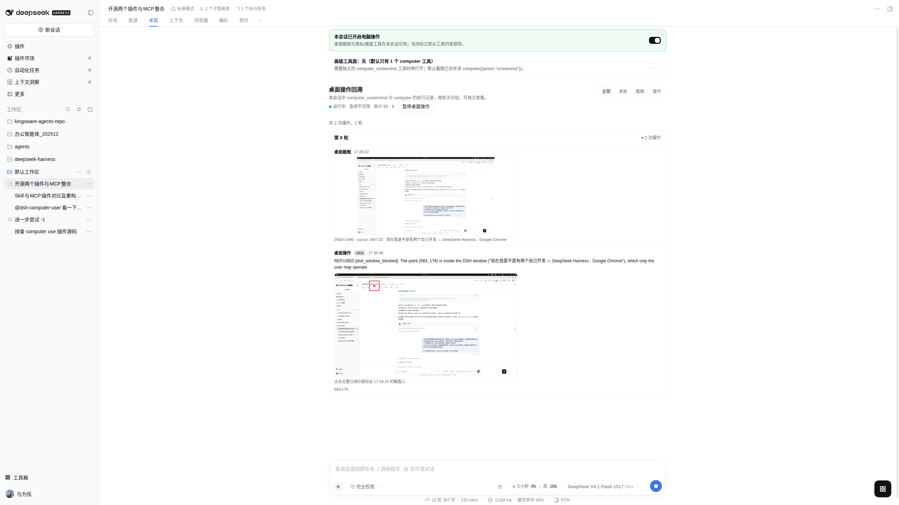

# dsh-computer-use

English | [简体中文](README.zh-CN.md)

**A DeepSeek Harness (DSH) plugin for real desktop control: one `computer` tool by default (screenshot action + native mouse/keyboard input with a one-shot observation token), guarded by intent, risk, approval, audit and an emergency pause. An opt-in advanced surface exposes the standalone `computer_screenshot` tool.**

It is not a screenshot-understanding model and not a workflow engine. The plugin provides the deterministic desktop *I/O primitives and safety layer*; the agent decides what to click, and the host's approval policy decides whether a risky action is allowed.

- Native backends, no OCR, no cloud calls, no runtime npm dependencies: Windows uses Windows PowerShell 5.1 with an in-memory C# `SendInput` helper (`backends/win32.mjs`); Linux uses X11 tools (`xdotool`, `scrot`/`import`/`xwd`, `xprop`, `xwininfo`, `xrandr`) through `backends/linux-x11.mjs`.
- Observe → act → observe: every screenshot mints a single-use `state_id`; every input action must present it and is re-verified immediately before dispatch.
- Intent, risk and approval: activating actions need a short `intent`; risky intents, windows and key chords are graded and routed through the DSH approval seam, which fails closed.
- Audit and pause built in: every attempt is appended to a local JSONL audit trail (never the typed text), and a pause file blocks all input until the user releases it.
- Opt-in per conversation: tools are only registered after the conversation's Desktop tab switch is enabled (default: one `computer` tool; `computerUseAdvanced` adds the separate `computer_screenshot`); the flags live in `~/.dsh/capability-toggles.json`.
- Native DSH integration: a Desktop conversation view, tool cards, English/Chinese locale, and an optional `computerUse` provider slot — the tools keep working even if another plugin owns that slot.

Linux/X11 and Windows are supported. **Wayland and macOS are not.** See [docs/PLATFORMS.md](docs/PLATFORMS.md).

---

## Contents

- [What it is](#what-it-is)
- [Features](#features)
- [How it compares](#how-it-compares)
- [Requirements](#requirements)
- [Install](#install)
- [Enabling per conversation](#enabling-per-conversation)
- [Quick start](#quick-start)
- [Tools](#tools)
- [Observation tokens and safety flow](#observation-tokens-and-safety-flow)
- [Files and state](#files-and-state)
- [Safety warning](#safety-warning)
- [Limitations](#limitations)
- [Documentation](#documentation)
- [License](#license)

---

## Screenshots



The Desktop tab groups screenshots and input actions by round, enlarges the captures, and boxes the
click position on the screenshot the action was taken against — so a session can be reviewed after
the fact. The image above is a real run on this repository (English UI labels are localized).

## What it is

`dsh-computer-use` is a plugin for DeepSeek Harness (DSH) that registers two model-facing tools:

| Tool | What it does |
|---|---|
| `computer_screenshot` | Captures **one monitor** to a PNG and returns the path, geometry, cursor, foreground window, the monitor list and a fresh single-use observation token (`state_id`). In the default surface this action is `computer({action:"screenshot"})`; the standalone tool is advanced-only. |
| `computer` | Performs **one real input action** (or a short batch) on the desktop behind that token: move, click, double-click, right-click, drag, scroll, type, key — plus the flow actions `wait`, `sequence`, `inputcheck` and `pause`. |

The desktop primitives are native per platform; the tool contract, token lifecycle, risk policy, audit and pause are platform-agnostic and live in [`index.js`](index.js). The backend split is selected at runtime by [`backends/index.mjs`](backends/index.mjs).

## Features

Everything below is implemented in this repository and documented in [docs/ARCHITECTURE.md](docs/ARCHITECTURE.md).

- **Two native backends, no third-party runtime.**
  - **Windows**: Windows PowerShell 5.1 + an in-memory C# P/Invoke helper compiled with `Add-Type` (`SendInput`, foreground window, DPI awareness, monitor enumeration via WinForms `Screen.AllScreens`). Helpers are staged under `%LOCALAPPDATA%` so a Low-integrity workspace directory cannot silently swallow `SendInput`.
  - **Linux/X11**: `xdotool` for XTest input, a screenshot tool (`scrot` preferred; `import` and `xwd` are fallbacks), `xprop`/`xwininfo` for foreground-window facts and `xrandr` for monitors. PNG decode/encode/crop/scale is done with `node:zlib`; there is no image library dependency.
  - `package.json` declares **no runtime dependencies**. There is no OCR, no local model, no screenshot-understanding service and no outbound network client in the plugin (the Web client only calls the host's own same-origin routes).
- **Observation token, not a screenshot path.** On Linux a token is bound to the captured monitor; on both platforms it binds the foreground window identity (handle, title, process, bounds) and an 8×8 pixel fingerprint of that window (on Linux, a whole-monitor fingerprint is used when the window is elsewhere). The token is single-use, expires (default 180 s, configurable) and is superseded by a newer screenshot in the same conversation.
- **Re-proof immediately before dispatch.** The token is not trusted on its own: right before input is sent the plugin re-reads the monitor layout and foreground window and re-samples the fingerprint. Window/bounds/layout/pixel changes are refused as `stale_observation` instead of clicking blindly.
- **Intent/risk/approval integration.** Click/double-click/right-click/drag/type/key/sequence require a one-sentence `intent` (≤ 200 chars). Intents matching risky verbs (`send`, `delete`, `pay`, `password`, `install`, `confirm`, …), windows that look like banking/account/mail surfaces, and system-level chords (`Alt+F4`, `Ctrl+Alt+Del`, `Win+R`) are graded high risk. High risk requires `confirm_risk: true` and then goes through the DSH `approval` service; missing approval, a rejection, a cancellation or a `never` session policy refuses the action (fail closed).
- **Audit trail.** One JSON line per attempt under `~/.dsh/computer-use/audit.jsonl`: timestamp, session, call, action, intent, risk level, result, refusal code, coordinates, key chord and text *length* (the typed text itself is never recorded).
- **Physical pause.** The presence of `~/.dsh/computer-use/pause.json` blocks all input, including a sequence in the middle of a batch. The model can pause itself but can never resume: only the user can release the pause from the Desktop tab (the status route). On Windows and on X11 with `python3` + `Xlib`, a global hotkey (`Ctrl+Alt+Shift+Q`, fallback `Ctrl+Alt+Shift+F12`) writes the pause file as an emergency stop.
- **Per-session capability switch, off by default.** The tools are registered with a `when` predicate that reads the shared `~/.dsh/capability-toggles.json` store; the Desktop view's switch writes the same flag, so turning it off removes the tools for the next agent step without a restart.
- **DSH-window protection.** Input into the DSH window itself is blocked (`dsh_window_blocked`) because that window hosts install and authorization controls. On Linux the rule is target-level: keyboard actions are refused while DSH is focused, pointer actions only when their own target lands on DSH. On Windows the original blanket rule for activating actions is kept.
- **Diagnostics instead of raw tool errors.** `computer { "action": "inputcheck" }` probes the input path and environment — on Linux: session type, tools, monitor layout/DPI, pointer warp, clipboard helper, pause/lock state and emergency brake; on Windows: helper staging, integrity, lock state, dispatch confirmation, pointer drift and brake status. It returns installation hints and actionable diagnostics. Missing tools become structured refusals, not raw `scrot`/`xrandr` stack traces. Unsupported sessions (Wayland, no `DISPLAY`, other OSes) fail closed at backend selection.
- **DSH-native client UI.** A `conversation.view` tab (`Desktop` / `桌面`) with per-round activity, filters, enlarged screenshots and click markers; `tool.call.toolview` cards for `computer_screenshot` and `computer`; English and Chinese dictionaries; a plugin icon. See [`client.js`](client.js) and the generated [`client.web.js`](client.web.js).

## How it compares

The honest summary: this is a **desktop input primitive with a deterministic safety shell**, not an autonomous computer-use agent and not a browser automation framework.

| Approach | What it gives an agent | Safety model | Trade-offs |
|---|---|---|---|
| **pyautogui-style scripts** | A full Python API for mouse/keyboard and screenshots; the agent (or a wrapper) must write or run scripts | Whatever the script author implements; usually no observation token, pre-dispatch re-proof, approval seam or audit | Needs a bespoke script per task; coordinate/state races are easy to hit; no DSH integration |
| **Anthropic computer-use demo** | A reference `screenshot → mouse/keyboard action` tool loop with safety guidance | Example-level guardrails; approval/audit must be built by the adopter | A reference demo, not a packaged DSH plugin; you own the runtime, policy and UI |
| **Browser automation (Playwright/Selenium/Puppeteer)** | Reliable DOM-level browser control | Browser process sandbox plus selector-level determinism | Browsers only; cannot drive native apps or the OS; requires its own runtime |
| **dsh-computer-use** | Two DSH tools: one-monitor screenshots plus native mouse/keyboard input primitives, with explicit observation, intent and risk semantics | Deterministic pre-dispatch checks (single-use token, re-proof, monitor bounds, pause, DSH-window guard), host approval for graded-high-risk actions, audit and an emergency brake; opt-in per conversation | Real input, so no sandbox; Linux/X11 and Windows only; risk grading is heuristic, not an allowlist; no OCR/grounding |

This repository does **not** use or bundle pyautogui, Playwright, Selenium or Puppeteer, and it does not call an OCR or cloud vision API. See [CREDITS.md](CREDITS.md) for the projects that are actually used or referenced.

## Requirements

- **DSH** with a profile that supports plugins (tested with `0.2.2-rc.5`; the install example uses the `web` profile) and a browser for the Desktop view.
- **Node.js ≥ 22** (declared in `package.json`; the plugin uses ESM and Node built-ins only).
- **Linux**: an X11 session (`DISPLAY` set, `XDG_SESSION_TYPE` not `wayland`).
  - Required tools: `xdotool`, `xprop`, `xwininfo`, `xrandr`.
  - Recommended screenshot tool: `scrot`. `import` (ImageMagick) and `xwd` (x11-apps) are fallbacks.
  - Recommended helpers: `python3` + `Xlib` for the global emergency hotkey, and `python3` + GTK 3 (`python3-gi`, `gir1.2-gtk-3.0`) for reliable Unicode typing through the clipboard. Without GTK, ASCII typing falls back to raw key events and non-ASCII typing fails with `clipboard_unavailable`.
  - Debian/Ubuntu example:
    ```bash
    sudo apt install xdotool scrot x11-utils x11-xserver-utils
    # optional but recommended:
    sudo apt install python3-gi gir1.2-gtk-3.0 python3-xlib
    ```
- **Minimum install (nothing else is needed; there is no `npm install` for consumers and no build step):**

  | Platform | Must install | Optional / recommended |
  |---|---|---|
  | Linux X11 | `xdotool x11-utils x11-xserver-utils scrot` | `python3-xlib` (global emergency hotkey), `python3-gi gir1.2-gtk-3.0` (Unicode typing via clipboard) |
  | Windows 10/11 | nothing (Windows PowerShell 5.1 is built in) | — |

- **Windows**: Windows 10/11 with Windows PowerShell 5.1 (the default `powershell.exe`). No npm packages are required and the plugin itself does not need admin rights; helper files are staged under `%LOCALAPPDATA%\dsh-computer-use\helper`. Windows UIPI still blocks `SendInput` into windows at a higher integrity level, so run DSH and the target applications at the same elevation.

> **Windows status:** the Windows backend is implemented and covered by static/pure-function tests, but this repository has not validated it end-to-end on a real Windows desktop. Run `computer { "action": "inputcheck" }` and one screenshot first. See [docs/PLATFORMS.md](docs/PLATFORMS.md).

## Install

Install the plugin into a DSH profile from GitHub:

```bash
dsh plugin --profile web add github:nicken/dsh-computer-use
```

Then restart the DSH Web app if the plugin does not appear (profile plugins are composed at boot). The package ships with the generated client bundle, so no build step is needed on install.

The plugin's `dsh` metadata (`bundle.patch` → `cordis.patch.yml`) inserts the `computer-use` entry into the profile composition, and `package.json` contributes the Web client (`platform: web`, immediate, with the locale injection). For a local development checkout, see [docs/DEVELOPMENT.md](docs/DEVELOPMENT.md).

## Scope: the Harness host machine only

The plugin injects real input into the **operating-system session that runs the DSH host**
(`dsh web` / the DSH process). It is not a remote-desktop or browser-based remote-control
protocol:

- If you open the DSH Web UI from another computer, the agent still drives the **host machine's**
  desktop, never the computer you are browsing from.
- If DSH runs on a server, VM, container or WSL without an interactive desktop session, there is
  nothing to drive (Linux needs an X11 `DISPLAY`; Windows needs an unlocked interactive session).
  Wayland, headless containers and macOS are not supported.
- The DSH page itself is user-only: the plugin refuses to drive the DSH UI, so the agent cannot
  click its own control panel.

To control a different machine, install and run the DSH host on that machine (a dedicated VM is
recommended), then connect to its Web UI from wherever you like — the input still happens on the
machine that hosts the agent.

## Enabling per conversation

Computer use is **off by default and opt-in per conversation**:

1. Open a conversation in the DSH Web app.
2. Open the **Desktop** tab in the conversation view (the tab registered by this plugin as `computer-use`).
3. Turn on **Enable computer use**.

The switch reads/writes `~/.dsh/capability-toggles.json` (`{ "version": 1, "sessions": { "<sessionId>": { "computerUse": true } } }`), which is the same flag the tools' `when` predicate checks. Enabling takes effect for the agent's next step; disabling removes the registered tools from the next step onward (`computer`, plus `computer_screenshot` when the advanced surface is on). The in-conversation capability control for MCP/skill managers writes the same file, so either surface works.

If the switch is missing or the conversation has no id, the tools stay off. This is deliberate.

## Quick start

A typical agent loop (Linux/X11 semantics; see [Coordinates](#coordinates)):

```jsonc
// 1. Observe one monitor (omitting "screen" = primary / largest monitor)
{ "tool": "computer", "arguments": { "action": "screenshot", "screen": "auto" } }
// → path, width, height, originX, originY, cursor, foreground,
//   state_id, screen, screens
```

The PNG is **not attached automatically**. The agent must read the returned `path` with its image-reading tool to see it.

```jsonc
// 2. Act once, with an intent, under that token
{
  "tool": "computer",
  "arguments": {
    "action": "click",
    "x": 420,
    "y": 260,
    "intent": "Open the Settings menu in the test application",
    "state_id": "obs_…"
  }
}
// → ok, detail, cursor, foreground and a fresh observation
//   (path + state_id) for the next step
```

```jsonc
// 3. Inspect the new screenshot, then continue; a new screenshot
//    supersedes the previous token.
```

For a risky action the model must ask for the user's approval explicitly:

```jsonc
{
  "tool": "computer",
  "arguments": {
    "action": "click",
    "x": 640,
    "y": 480,
    "intent": "Submit the completed order form",
    "confirm_risk": true,
    "state_id": "obs_…"
  }
}
```

If the DSH session approval policy is `never`, such an action is auto-rejected with `risk_denied`.

### Coordinates

- **Linux/X11**: every `computer` coordinate (`x`, `y`, `toX`, `toY` and a scroll anchor) is **local to the monitor of the observation token**. The screenshot origin is the monitor origin. Switching monitors requires a new screenshot.
- **Windows**: action coordinates are **desktop-global**. A screenshot reports `originX`/`originY`; convert an on-image position with `global = origin + image position`.
- On Linux every coordinate must be inside the observed monitor; out-of-monitor points are refused as `invalid_args` before any input is sent. On Windows coordinates are desktop-global and were not validated against an individual monitor in this implementation.

## Tools

**Default surface: one tool.** `computer({action:"screenshot", ...})` is part of the `computer`
tool, so a session normally sees a single capability. The standalone `computer_screenshot` tool is
only registered when the per-conversation *advanced tool surface* switch is on (scripts and
compatibility). Both are documented below.

### `computer_screenshot`

| Parameter | Type | Meaning |
|---|---|---|
| `screen` | string, optional | **Linux**: omitted/`"auto"` → primary monitor (or the largest when none is primary); `"cursor"` → monitor under the pointer; otherwise a monitor id (e.g. `"HDMI-1-0"`) or index (`"1"`). **Windows**: omitted → primary; `"all"` → whole virtual desktop; otherwise monitor id (e.g. `"DISPLAY1"`, with or without the `\\.\` prefix) or index. |
| `region` | object, optional | Monitor-local crop `{ x, y, width, height }` (integers). Only this part is returned as the PNG. On Linux the observation token still binds the whole monitor. |
| `scale` | number, optional | Optional downscale factor for the captured crop (for example `0.5` halves both dimensions). |

Result fields:

| Field | Meaning |
|---|---|
| `path` | Absolute path of the PNG (read it as an image to actually see it). |
| `width`, `height` | Size of the returned image (cropped/scaled when requested). |
| `originX`, `originY` | Absolute desktop origin of the returned image's top-left pixel. |
| `cursor` | Cursor position `{ x, y }` (monitor-local on Linux; desktop-global on Windows). |
| `foreground` | Foreground window `{ title, process, handle, rect }`. |
| `state_id` | Single-use observation token (`obs_…`). |
| `screen` | The captured monitor `{ id, index, primary, x, y, width, height }` (plus `dpi`/`rotation` hints on Linux when available). |
| `screens` | Every monitor currently detected, same shape. |
| `region` | Echo of the crop `{ x, y, width, height, scale? }` when one was requested. |

The monitor layout is read on every call (hotplug, rotation and multi-monitor changes are not cached). An unknown monitor id is rejected with the list of detected monitors.

### `computer`

| Parameter | Type | Meaning |
|---|---|---|
| `action` | enum, required | `move`, `click`, `double_click`, `right_click`, `drag`, `scroll`, `type`, `key`, `wait`, `sequence`, `inputcheck`, `pause`. |
| `state_id` | string | Observation token. Required for every input action and for `sequence`; not required for `wait`, `inputcheck` or `pause`. |
| `intent` | string (≤ 200) | One sentence describing the goal. Required for `click`, `double_click`, `right_click`, `drag`, `type`, `key` and `sequence`; graded for risk and written to the audit trail (truncated to 120 chars). |
| `confirm_risk` | boolean | Accept that a high-risk action goes through user approval. Without it, a high-risk action is refused before anything happens. |
| `x`, `y` | integer | Target for `move`, click actions, drag start, or scroll anchor. |
| `toX`, `toY` | integer | Drag end point (`drag` only). |
| `delta` | integer | Wheel delta for `scroll`: negative scrolls down, positive up, one notch is `120` (default `-120`). |
| `text` | string (≤ 4000) | Text for `type` (Unicode). |
| `keys` | string | Key combination for `key`, e.g. `"Ctrl+Shift+I"` or `"Enter"`. Modifiers: Ctrl/Control, Shift, Alt, Win/Meta/Cmd; named keys include Enter/Return, Tab, Escape/Esc, Space, Backspace, Delete/Del, Insert, Home, End, PageUp, PageDown, Up/Down/Left/Right (and Arrow aliases), CapsLock, PrintScreen, F1–F12. A single modifier key is allowed. |
| `ms` | integer | `wait` duration, 1–30000 ms (default `500`). |
| `steps` | array (1–20) | `sequence` steps: input actions (`move`, `click`, `double_click`, `right_click`, `drag`, `scroll`, `type`, `key`) without `state_id`; steps cannot nest `sequence`. Combined step text is limited to 8000 characters. |

Action-specific requirements:

- `move`, `click`, `double_click`, `right_click` need `x` and `y`.
- `drag` needs `x`, `y`, `toX`, `toY`.
- `scroll` accepts optional `x`/`y`; without them it scrolls at the current pointer.
- `type` needs `text`; `key` needs `keys`.
- `sequence` inherits the monitor of the token, re-checks the brake between steps, and (on Linux) re-proves the observation before every step.
- `inputcheck` injects nothing while paused or locked; it diagnoses the input path and environment.
- `pause` is idempotent and requires no token; the model can pause but cannot resume.

A successful input action (and `wait`) returns a **fresh screenshot and observation**:

```jsonc
{
  "ok": true,
  "action": "click",
  "detail": "clicked left at (420, 260)",
  "cursor": { "x": 420, "y": 260 },
  "foreground": "Test application — main window",
  "observation": {
    "state_id": "obs_…",
    "path": "<DSH_HOME>/computer-use/shots/shot-….png",
    "width": 1920,
    "height": 1080,
    "originX": 0,
    "originY": 0,
    "screen": { "id": "HDMI-1-0", "…": "…" }
  }
}
```

`sequence` also returns `steps: [{ action, detail }]`. A failure returns `ok: false` with `code`, `message` and a `guidance` string; when relevant it also carries `foreground`, `risk`, `steps` and `blockedStep`.

### Refusal codes

| Code | Meaning |
|---|---|
| `missing_observation` | No `state_id` was supplied. |
| `observation_expired` | Unknown token, token from another conversation, or older than the TTL. |
| `observation_used` | The token was already consumed by a dispatched action. |
| `observation_superseded` | A newer screenshot exists in this conversation; use its token. |
| `stale_observation` | The layout, foreground window, window bounds or sampled pixels changed after the screenshot. |
| `foreground_unreadable` / `observation_unverifiable` | The foreground state cannot be re-read; fail closed. |
| `intent_required` | An activating action was called without `intent`. |
| `risk_approval_required` | Graded high risk; retry with `confirm_risk: true` if intended. |
| `risk_denied` / `risk_unavailable` | Approval was rejected/cancelled, or the approval service is missing — fail closed. |
| `invalid_args` | Bad action arguments, out-of-monitor coordinates, invalid region/scale, or a blocked step. |
| `paused` | The user's emergency pause is active. |
| `desktop_locked` | The OS session is locked, so injected input would be discarded. |
| `dsh_window_blocked` | The target is the DSH window, which only the user may operate. |
| `window_unidentified` / `window_probe_failed` | The target window identity cannot be established; fail closed. |
| `pointer_warp_unstable` / `drag_unstable` | The pointer/drag end point could not be verified; the plugin refuses to report a blind success. |
| `clipboard_unavailable` | Non-ASCII typing needs the GTK clipboard helper, which is unavailable. |
| `unsupported_platform` | Wayland, a missing `DISPLAY`, or an unsupported OS. |
| `inputcheck_failed` / `action_failed` | The self-check or the helper reported a failure; read `message`/`guidance`. |

Refusals include actionable `guidance`, e.g. "call computer_screenshot again and use the new state_id".

## Observation tokens and safety flow

1. `computer_screenshot` captures exactly one monitor and mints a token. The token binds the foreground window identity and an 8×8 pixel fingerprint of the foreground window; on Linux it also binds the monitor geometry, and falls back to a whole-monitor fingerprint when the window is elsewhere (`fingerprintTarget` records `window`, `screen` or `none`).
2. The token is reserved atomically by the first input call in the conversation. If that call is refused before dispatch (bad args, missing intent, missing/denied approval), the reservation is released so the same `state_id` can be retried. Once an action is actually dispatched, the token is consumed.
3. Immediately before dispatch, the plugin re-enumerates the monitor layout, re-reads the foreground window (handle, bounds) and re-samples the fingerprint. Any change is refused as `stale_observation` with a subtype (`window`, `bounds`, `layout`, `pixels`).
4. A success (including `wait`) returns a new screenshot and token; a new screenshot invalidates the previous token. Tokens expire after 180 s by default (`policy.json` → `observationTtlMs`, or `DSH_COMPUTER_USE_OBSERVATION_TTL_MS`; clamped to 5 s–30 min). Up to 200 tokens are kept in memory per process.
5. The pause file is checked at the tool layer, again at the backend injection point, and between `sequence` steps, so an emergency stop also interrupts a batch.

## Files and state

All plugin state lives under `$DSH_HOME/computer-use/` (`$DSH_HOME` defaults to `~/.dsh`):

| Path | Purpose |
|---|---|
| `shots/` | PNG screenshots; the newest 60 are kept. |
| `audit.jsonl` | One JSON line per dispatch attempt; typed text is never stored (only `textLength`). |
| `pause.json` | Emergency pause record. Its presence blocks input. |
| `brake.json`, `brake.stop` | Emergency-hotkey watcher status / stop request. |
| `policy.json` | Optional: `observationTtlMs`, `riskyIntent`, `riskyIntentReplace`, `riskyApp`, `riskyAppReplace`. |
| `~/.dsh/capability-toggles.json` | Shared per-session capability store; this plugin touches only `sessions.<id>.computerUse`. |
| `%LOCALAPPDATA%\dsh-computer-use\helper` (Windows) | Staged PowerShell helper scripts. |

Screenshots are served to the authenticated DSH Web UI through `/api/computer-use/shot` (`GET`/`HEAD`, PNG filenames only, traversal rejected). The status route `/api/computer-use/status` is the user's pause/resume channel; `/api/computer-use/capability` backs the per-conversation switch. None of these routes is exposed as a model tool.

## Safety warning

This plugin performs **real mouse and keyboard input on a real desktop**, with the same power as the user at the keyboard. Read this before enabling it:

- **Use a dedicated VM or a dedicated desktop session.** Do not run it on a machine holding credentials, private messages or irreplaceable data unless you accept the risk. Treat it as remote-control software, not as a sandbox.
- **Screenshots are privacy-sensitive.** They are stored under `~/.dsh/computer-use/shots/` and can contain passwords, tokens, customer data or personal information. They are not redacted. They can be presented to the model when the agent reads the screenshot path, and are served to the authenticated DSH UI. Keep the desktop clean, close sensitive windows, and clear the shots directory if needed.
- **Prompt injection is a real path to action.** The risk policy matches text and app surfaces heuristically; a malicious page or document can try to phrase a request as a neutral intent. Approval prompts, the per-session switch and the audit trail are the defenses — use them, and review what the agent did.
- **Typing is not secret-safe.** On Linux `type` injects through the clipboard (temporarily owning it, then restoring the previous text), so clipboard managers may retain what was typed. Avoid having the agent type passwords; use the application's own authentication flow.
- **The plugin is not an allowlist or a security boundary.** It can drive any application the user can drive (except the DSH window, which is guarded). OS-level isolation, separate accounts, network policy and backups remain your responsibility.
- **The DSH-window guard is a safety measure, not a sandbox.** It blocks automated input into DSH's own window; it cannot classify every other privileged window. Leave the pause hotkey within reach.
- **No outbound network calls.** The plugin does not upload screenshots or call cloud services; the Web client only talks to DSH's own same-origin routes. Screenshots still reach the model provider through your normal DSH conversation when the agent reads them.
- **Disable when done.** Turn the per-conversation switch off, or use `pause`, when the agent does not need the desktop.

See [docs/SECURITY.md](docs/SECURITY.md) for the threat model and deployment recommendations.

## Limitations

- **Wayland is not supported** (including XWayland-only sessions): there is no global X11 input injection or global foreground window. The backend refuses at selection time with a clear reason.
- **macOS and other platforms are not supported** yet.
- **One monitor per screenshot.** To act on another monitor, take a new screenshot of it. On Linux a token is bound to the captured monitor.
- **Windows action coordinates are desktop-global**, unlike Linux's monitor-local coordinates. This is intentional in the current implementation; the tool description spells it out. Windows has not been validated end-to-end on real hardware in this repository.
- **Risk grading is heuristic.** It looks at intent text, the foreground app's title/process and system key chords. It is not a semantic classifier and does not know your business rules; extend `policy.json` or rely on approval policy.
- **No OCR, no element grounding, no app-specific drivers.** The agent must read the screenshot and compute coordinates.
- **No screen redaction, no per-app allowlist, no sandbox.**
- **`sequence` re-proves the state between steps**, so long batches pay roughly a few hundred milliseconds per step (Linux). This is deliberate; do not weaken it without reviewing the threat model.
- **Lock detection is best-effort** (logind/DBus/lock-window probes on Linux; `DesktopLocked` on Windows). A lock state that cannot be detected may still cause injected input to be discarded.
- **Clipboard restoration is best-effort**: very large/binary clipboards, clipboard managers and helper lifetime can affect what is restored.
- **Emergency hotkey on Linux needs `python3` + `Xlib`** and may be unavailable in minimal sessions; pause from the UI still works and `inputcheck` reports the real reason.
- **Unicode typing on Linux needs GTK 3**; without it, ASCII falls back to raw key events and non-ASCII fails with `clipboard_unavailable`.
- **Screenshot retention is 60 files**, and the token map is in memory: a host restart invalidates outstanding tokens (`observation_expired`).
- **Multi-monitor layouts have been exercised on a limited set of real configurations**; after changing displays, run `inputcheck` first.
- **No auto-update**; update through the DSH profile plugin mechanism.

## Documentation

| Document | Contents |
|---|---|
| [docs/ARCHITECTURE.md](docs/ARCHITECTURE.md) | Layers, backend contract, token lifecycle, risk/approval, audit, pause, capability switch, DSH integration points. |
| [docs/PLATFORMS.md](docs/PLATFORMS.md) | Linux/X11 dependencies and coordinate rules, Windows backend details, Wayland limits, troubleshooting. |
| [docs/SECURITY.md](docs/SECURITY.md) | Threat model, default boundaries, approval policy, deployment guidance, reporting. |
| [docs/DEVELOPMENT.md](docs/DEVELOPMENT.md) | Local profile link setup, repository layout, client build, code style, release process. |
| [docs/TESTING.md](docs/TESTING.md) | Three test layers, commands, CI matrix and local reproduction. |
| [docs/TOOL-SURFACE.md](docs/TOOL-SURFACE.md) | Why the default surface is one `computer` tool and how the advanced switch restores `computer_screenshot`. |
| [docs/demo-2026-11-10-baidu-news.md](docs/demo-2026-11-10-baidu-news.md) | A real-machine end-to-end session (Linux/X11) used as a regression reference. |
| [backends/CONTRACT.md](backends/CONTRACT.md) | Backend contract, coordinate rules and invariants (Chinese). |
| [CHANGELOG.md](CHANGELOG.md) | Version history. |
| [CREDITS.md](CREDITS.md) | Projects used or referenced. |
| [CONTRIBUTING.md](CONTRIBUTING.md) | Issues, pull requests, tests and conduct. |

## License

MIT — see [LICENSE](LICENSE).
